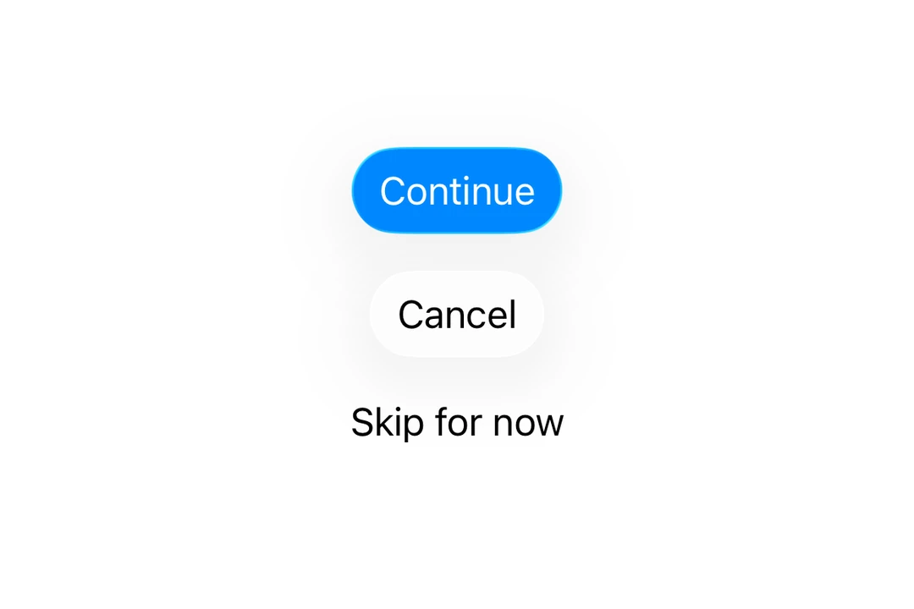
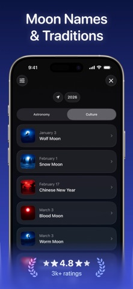
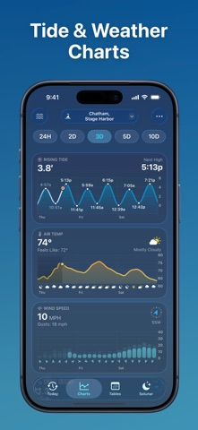
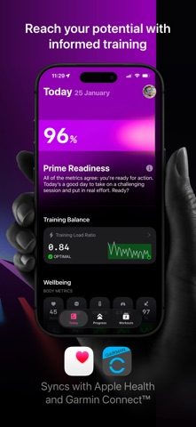
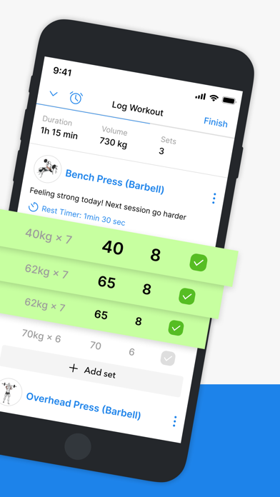

# Visual references for the Dawnage direction

These images were retrieved and inspected during the September 23–24, 2026 research. They are **source references, not a Dawnage redesign or a hands-on audit of these apps**. Full-resolution originals and attribution metadata are retained in [reference-images.json](evidence/reference-images.json). They must not be shipped as Dawnage product assets.

The recommended direction combines native control hierarchy, quiet grouped content, and Dawnage coral used selectively. It does not copy another app’s brand.

## Native button hierarchy — official Expo SDK 57 example

The useful distinction is **prominent / secondary / inline**, including native interaction and adaptation. In Dawnage, a primary content action uses the appropriate filled native style; glass is reserved for appropriate floating controls. The blue in this example becomes Dawnage’s measured coral where prominence is warranted.

Source: [Expo SDK 57 Button documentation](https://github.com/expo/expo/blob/sdk-57/docs/pages/versions/unversioned/sdk/ui/swift-ui/button.mdx).

## Moonlitt — grouped content and compact controls

Borrow the compact selection and navigation controls, separation between content and chrome, and restrained grouped rows. Its purple/blue branding is not part of the Dawnage proposal. Apple named Moonlitt the 2026 Interaction winner and praised its Liquid Glass integration.

Source: [Moonlitt on the App Store](https://apps.apple.com/us/app/moonlitt-moon-phase-tracker/id6444718902), version 2.9 in the lookup at retrieval.

## Tide Guide — readable data and small controls

Borrow the relationship between a headline value, its graph, and compact range controls. Dawnage’s progress screen can use that hierarchy without copying a tide chart, its blue palette, or its metrics. Apple listed Tide Guide as a 2026 Interaction finalist.

Source: [Tide Guide on the App Store](https://apps.apple.com/us/app/tide-guide-charts-tables/id1406371071), version 27.0.4 in the lookup at retrieval.

## The Outsiders — strong hierarchy, deliberately different styling

Borrow the clear order of information: the important state first, supporting information below. Its bright magenta and black direction is more expressive than the chosen Dawnage style. Do not add a readiness percentage unless Dawnage has a justified, implemented metric behind it. Apple listed this app as a 2026 Interaction finalist.

Source: [The Outsiders on the App Store](https://apps.apple.com/us/app/the-outsiders-athlete-tracker/id6751584800), version 1.8.1 in the lookup at retrieval.

## Hevy — workout workflow reference

Use this as a **workflow reference**: readable weight/repetition values, a short route to completing a set, and context from previous work. This marketing image has older visual treatments; it is not evidence of the latest Apple visual style and should not be cloned. The current feature documentation, rather than screenshot age, supports the recommendation to retain efficient set logging and nearby rest controls.

Source: [Hevy feature documentation](https://www.hevyapp.com/features/) and [App Store listing](https://apps.apple.com/us/app/id1458862350), version 3.1.15 in the lookup at retrieval.

## Visual acceptance still required

The current Dawnage capture attempt failed before a screenshot was produced. The implementation should therefore begin with a native control comparison and real current-app captures, then review Home and Training in light, dark and large text. The research report’s source-level findings are not a substitute for that visual check.
