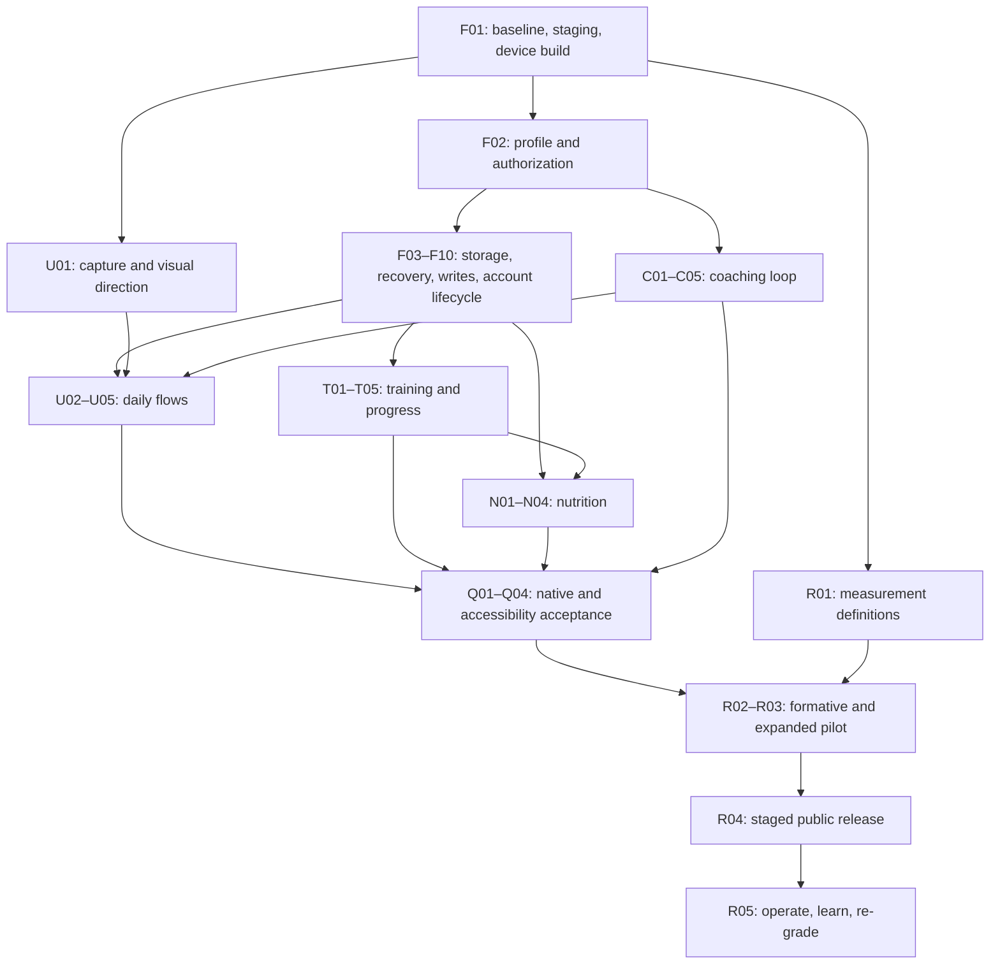

# Dawnage Product Excellence Implementation Plan

> **For agentic workers:** REQUIRED SUB-SKILL: Use superpowers:subagent-driven-development (recommended) or superpowers:executing-plans to implement this plan task-by-task. Steps use checkbox (`- [ ]`) syntax for tracking.

**Goal:** Deliver a premium human-coached fitness app that earns high marks through dependable daily use, visible coaching value and verified native quality.

**Architecture:** Extend the existing Expo mobile client and React coach dashboard. Keep Supabase as the data/auth boundary; introduce typed additive contracts, transactional RPCs and a small privileged Edge Function layer. Preserve the existing logger, theme and health/native adapters.

**Tech Stack:** Expo 57, React Native 0.86, React 19, TypeScript, TanStack Query, Supabase Postgres/Auth/Storage/Edge Functions, existing web React/Vite dashboard, Jest, Maestro, EAS and GitHub Actions.

**Spec:** [Product design specification](../specs/2026-09-26-product-excellence-design.md). Read the spec and the relevant work package before implementation.

## Global Constraints

- Scope is the human-coached product in `mobile/`, plus necessary `client/`, `shared/`, and Supabase changes; `mobile-2/` is excluded.
- Preserve existing working-tree changes, historical records, local reporting dates, and legacy readers; use additive migrations and reversible feature rollout.
- All applicable daily check-in fields remain required by default; a shorter protocol requires an explicit, versioned, coach-assigned experiment.
- Missing is not zero; prescribed is not consumed; saved, synced, completed, reviewed, and acknowledged are separate facts.
- Use fictional test records and least-privilege access; never put credentials or privileged keys in clients, or health values, photos, and free text in analytics.
- Core journeys must work on iOS and Android; native-only extras must have honest fallbacks, and release claims require fresh device and server evidence.

---

## Executive direction

The user selected **a premium app for clients working with a human coach**. The roadmap prioritizes this loop:

**Understand today's plan → perform/log it → receive a coach decision → understand progress → adapt the next day.**

The “10/10” ambition covers the whole service. More features alone do not achieve it. A broad public launch must wait for the quality gates; the final grade is reassessed from evidence, not promised now.

The [September 26 review](../../review/2026-09-26-market-audit/README.md) supplies the starting findings. Its current visual audit is incomplete. TypeScript and static UI rules passed; no current full Jest, native-build, live authorization or rendered-screen pass should be inferred.

Planning is complete when this specification, task packages and their dependency/acceptance map are consistent. Implementation has not begun merely because these documents exist.

## Work packages and outcome order

| Package | Work | User-visible outcome | Prerequisite | Indicative engineering effort |
| --- | --- | --- | --- | --- |
| [A — Foundations and trust](2026-09-26-product-excellence/01-foundations.md) | F01–F10 | Saved work stays accessible, statuses are truthful, sensitive data is protected | Current audit | 6–8 person-weeks |
| [B — Coaching service](2026-09-26-product-excellence/02-coaching.md) | C01–C05 | Real coach connection, response, follow-up and useful notifications | F01/F02/F07; F05 for delivery | 5–7 person-weeks |
| [C — UI and daily experience](2026-09-26-product-excellence/03-experience.md) | U01–U05 | Cohesive native screens, simpler entry, clear first week and next action | F01; B contracts for coach surfaces | 3–5 person-weeks |
| [D — Training and progress](2026-09-26-product-excellence/04-training-progress.md) | T01–T05 | Credible progression, approved alternatives and understandable outcomes | F06/F07; chosen U01 direction | 4–6 person-weeks |
| [E — Nutrition in daily life](2026-09-26-product-excellence/05-nutrition.md) | N01–N04 | Practical portions/swaps and reviewed actual intake | F02/F07; plan version contract | 3–5 person-weeks |
| [F — Native quality](2026-09-26-product-excellence/06-native-quality.md) | Q01–Q04 | Accessible, responsive iOS/Android behavior under real conditions | Feature increments as available | 3–4 person-weeks |
| [G — Evidence and launch](2026-09-26-product-excellence/07-validation-release.md) | R01–R05 | Measured usefulness, sustainable coach workload and controlled release | Gates below | 2–4 person-weeks plus study elapsed time |

Total initial envelope: **26–39 engineering person-weeks**. Planning range: **16–22 calendar weeks with two experienced engineers**, a half-time product designer, part-time QA/device support and an available coach lead. With one engineer, expect roughly **28–42 calendar weeks**. These are scope estimates, not delivery commitments; F01 turns them into a measured forecast. Signing accounts, staging access, device availability, cohort recruitment and coach decisions can extend calendar time. Do not compress validation to make a date.

Existing deployment/hosting costs and new staging, signed builds, devices, notification delivery, monitoring and study incentives belong in a budget worksheet during F01. Obtain actual vendor quotes; this plan does not invent a fixed rupee/dollar budget.

## Dependency map

The broad arrows identify integration dependencies; each task lists its exact prerequisites. U01 research and R01 measurement definitions can run while foundations are repaired. Native acceptance is performed incrementally, not deferred until a last-week test pass. The full nutrition workflow depends on shared plan-version publication from T01; its food model/content preparation may start earlier.

## Milestones, with acceptance gates

| Gate | Deliverables | Must be true to proceed |
| --- | --- | --- |
| **G0 — A trustworthy baseline** | F01, U01 baseline captures, R01 measurement design | Current signed iOS/Android preview works; staging reflects the actual schema; existing tests and device flows have explicit results |
| **G1 — Trustworthy core** | F02–F10, F06 completion semantics everywhere | Cold offline recovery works; acknowledged entries survive interruptions; direct authorization checks pass; account/privacy controls work |
| **G2 — A complete coaching service** | C01–C05, U02/U03, initial U04 | A dedicated test client submits, coach replies in web, client receives/views/acknowledges and can follow up; no invented read/delivery claims |
| **G3 — A premium daily experience** | U01 chosen direction and U02–U05, T01–T05, N01–N04 | Core screens/states reviewed; goal progress, alternatives and actual intake round trips work with compatible legacy readers |
| **G4 — Real-device quality** | Q01–Q04 | Accessibility, keyboard/gesture, health permissions, background/rest, performance and interruption matrix passes |
| **G5 — Validated private beta** | R02–R03 | Formative usability targets met; expanded pilot has at least 1,000 sessions and 50 eligible reviews; service and stability targets met with raw counts |
| **G6 — Controlled public launch** | R04 | No unresolved release blockers, restore/rollback rehearsed, store artifacts truthful, support/on-call and deletion processes staffed |
| **G7 — Sustained quality** | R05 | Four-week operating review, repeat user tasks and independent re-score based on evidence, with a funded next-priority list |

No aggregate score compensates for lost data, cross-account access, an unusable critical flow or an unstaffed coaching promise. Those are release blockers.

## Calendar model

- **Weeks 1–2:** baseline, current native screenshots, applied-schema/authorization inventory, instrumentation definitions and design options.
- **Weeks 2–5:** trust repairs and account lifecycle. Start the server coaching contracts and coach queue after profile permissions are safe.
- **Weeks 4–8:** coach loop, onboarding/Home, daily check-in efficiency and the selected visual direction.
- **Weeks 7–12:** training progression/alternatives, nutrition actions and unified progress, with weekly native checks.
- **Weeks 11–15:** cross-device refinement and the first formative study; correct critical findings before expanding.
- **Weeks 14–20:** four-week expanded pilot, migration/rollback rehearsal, store preparation and measured service operation.
- **Weeks 20–22 if required:** evidence gaps, release-blocker fixes and staged rollout.

This model overlaps independent work; it does not authorize enabling unfinished features together. Reforecast at G0, G2 and G4 using completed tasks, review throughput and remaining failures. A credible smaller release can omit optional additions, but must still pass G1/G2/G4 for the features it offers.

## What changes for the client

**First session:** clearly see the assigned coach or a real enrollment/help path, understand the coaching agreement, complete only initial essentials, and reach a useful task. Keep the long assessment separate, branched and resumable.

**Every day:** Home shows one next action. Required check-in data can be recorded incrementally, imported with review or drawn from confirmed intake. The primary action is reachable and every saved/synced state is accurate.

**Every workout:** previous comparable performance, easy entry/undo, clear targets, recovery after closure and truthful partial completion. A client can use an approved shorter/equipment alternative without corrupting the original prescription.

**Every week:** the client sees a coach-authored interpretation, exact plan changes or the reason to continue, and one focus. The coach can fulfill this through a manageable web queue.

**Over time:** progress reflects the client's goal and data quality, and supports useful conversation. Quiet periods lead to a supportive return, not an intimidating backlog.

## Market position and scope choices

Start with clients already enrolled in Dawnage's human coaching service. The existing coaching/package business supplies the service relationship; a new in-app subscription or marketplace is not assumed. Independently registered users need a real enrollment/help path and honest assignment status. Confirm storefront payment rules for the actual commercial model during release preparation.

The [official-source market research](../../review/2026-09-26-market-audit/market-research.md) supports the following priorities. These are opportunities to execute well for Dawnage's clients, not claims that no competitor has a similar feature.

| Market expectation / opportunity | Dawnage response | Delivery |
| --- | --- | --- |
| Trainerize, Everfit and Hevy Coach make plans, logging and coach communication familiar expectations | Finish the reliable client-to-coach loop before adding breadth | F01–F10, C01–C05 |
| Future and FITTR emphasize the value of a human coach | Make the coach's observations, decisions, plan changes and next action visible | C01–C05, T01 |
| Fitbod and Freeletics make adaptation a strong expectation | Offer client-specific alternatives approved by the coach for time/equipment constraints | T03 |
| Healthify and MacroFactor make nutrition useful during the day | Start with reviewed portions, approved swaps, actual meal confirmation and check-in reconciliation | N01–N04 |
| Mature products make frequent actions feel effortless | Refine daily entry, gym execution, accessibility and real-device performance | U01–U04, T02, Q01–Q04 |
| Charts alone do not explain what to do next | Connect goal-specific trends with the coach's weekly decision | T04–T05, C03 |

**Smallest credible first release:** trustworthy storage/account lifecycle, an operational coach-response path, optimized strict check-in, dependable workout logging, clear assigned meals, basic goal progress and native acceptance. Approved alternatives, richer meal confirmation and deeper progress can be introduced through private cohorts as their contracts pass. The full excellence scope includes these improvements before re-grading the whole product. U05 may conclude with retaining the strict protocol; groceries and AI remain explicitly optional.

Public availability of a smaller scope still requires the same privacy, reliability, accessibility and service gates for every offered capability. Reforecast effort if optional work is removed; do not silently label an incomplete full-scope milestone as passed.

## Visual quality requirements

U01 produces current-screen evidence and a chosen design direction before production visual changes. Deliver a screen/state inventory, type/spacing hierarchy, reusable card/list/control rules, native light/dark specimens, icon/content guidance and motion specifications. Required screens include entry, setup, Home, check-in stages/receipt, training/history, logger/rest/overview, nutrition/details/swaps, Coach/thread, Progress/photos and account controls.

Use motion to show causality, selection and save completion; respect reduced motion and avoid blocking repeated gym actions with celebrations. Display phone-scale prototypes and test one-handed reach, keyboard presence and large text. Beautiful empty/error/loading states are part of the deliverable. This plan does not pick unseen pixel changes from source alone.

## Capability flags and rollout

Create server-provided, account-scoped flags `coaching_v1`, `plan_versions_v1`, `meal_entries_v1`, `nav_candidate_v1`, and `short_checkin_pilot_v1`. Privileges are enforced independently by RLS/RPC. Flags control exposure, not authorization. Default all new product capabilities off until their contracts/readers are deployed. Keep legacy routes/readers until usage and compatibility evidence allow retirement.

A flag rollback stops new creation/entry into the affected feature but retains access to already-published responses, submitted intake and recovery data. Do not delete tables/data during an emergency rollback. Schema retirement requires a separate reviewed migration after legacy versions are no longer supported.

## Operating and decision ownership

| Responsibility | Owner role | Decision/deliverable |
| --- | --- | --- |
| Product scope / visual direction | Founder/product lead | Approves concrete artifacts, service promise and evidence-based scope tradeoffs |
| Coaching rules / alternatives / nutrition | Coach lead | Required protocol, response coverage, safe approved alternatives, useful review format |
| Mobile delivery | Mobile engineer | iOS/Android state, interaction and device evidence |
| Data/security/web | Backend/web engineer | Applied schema, migrations, access boundaries, coach UI and background jobs |
| Design/research | Product designer | Native screen review, prototypes, task studies and accessible hierarchy |
| Release verification | QA/release owner | Failure matrix, build evidence, rollout/rollback and incident runbook |

Roles may be combined on a small team. They must still have explicit owners before G1. Do not let a technical implementer silently decide the coaching service's nutritional protocol or response commitments.

## Code structure to maintain

Keep route files responsible for navigation and screen composition. A domain feature owns its models, queries/mutations, controller, UI and focused tests. Shared controls stay in `mobile/src/components/ui`; account storage, synchronization adapters and telemetry belong in cross-feature infrastructure. Put platform-independent rules used by both clients in `shared/`, and keep generated database definitions separate from domain/view models.

The new `supabase/` directory owns reviewed migrations, direct authorization tests and privileged Edge Functions. The existing `client/` remains the coach/admin dashboard. Move existing code when a responsibility changes; do not spend this roadmap on a wholesale folder rewrite. Cross-client completion, plan versions, nutrition provenance and write acknowledgments are the first contracts to consolidate.

## Delivery risks and explicit responses

| Risk | Consequence | Response / owner |
| --- | --- | --- |
| Applied schema differs from repository SQL | Unsafe migrations or broken legitimate access | F01 inventories/restores staging; backend owner reviews every additive migration |
| New encrypted persistence is incompatible with a native build | Recovery or installation regression | F01 compatibility spike and F03 interrupted-migration/device evidence before rollout |
| Coach demand exceeds review capacity | Premium promise fails despite a polished app | C05 measures workload; coach lead limits enrollment and supplies coverage |
| New flows add more daily effort | Lower completion and less useful data | U04 baseline and R02 timed tasks; product lead removes friction before broader rollout |
| New/old clients disagree about records | Wrong progress, duplicates or unreadable history | Shared contracts, immutable versions, legacy-reader tests and cohort flags |
| Device/study access or signing delays | Calendar estimate expands | Identify owners/access at G0 and reforecast; do not substitute web evidence for native checks |

## Deliberately gated additions

A full food database, food-image calorie AI, a social feed, leaderboards, video calls, a full watch app, billing expansion and autonomous programming are outside the base delivery scope. None is necessary to earn a high-quality rating for this chosen service. After the pilot, a coach-only AI summary draft may be evaluated with source-grounding, omission/hallucination checks and explicit human publication; ship only if it saves coach time without lowering decision quality.

## Execution rules and evidence

All paths inside work packages are repository-relative unless stated otherwise. “Create” paths are proposed new files. Test snippets are concrete behavioral examples to add during implementation, not a claim that they already exist or pass.

For each coding task: write the specified failing behavior test, observe the failure, implement the smallest coherent change, run focused checks, review compatibility and record evidence. For reversible copy/design documentation, inspect the actual artifact instead of adding tests that mirror wording. Finish an independently reviewable task before moving on; avoid a giant all-features branch. Commit only the task's files after verification, respecting current user changes and active session authorization.

Complete the existing `cd mobile && npm run verify` and native export/dependency checks at integration boundaries. Backend SQL tests require a disposable local/staging Supabase instance; web contract tests and `npm run build` run at repository root. R01 extends the existing CI workflow to include the new contract/Edge Function tests. Do not report source tests as device evidence.

Store acceptance evidence under `mobile/docs/release/product-excellence/` with commit/build identifier, platform/device/OS, scenario, result and artifact. Sanitize all fixtures/logs. Every gate links to its evidence and names any unresolved limitation.

## First execution slice

- [ ] F01: make the current code demonstrably runnable and establish the applied schema/test baseline.
- [ ] F02: close client-profile/role/private-note permission gaps before extending data access.
- [ ] F03/F04: preserve sensitive local work and make offline recovery reachable.
- [ ] F05/F06/F07: centralize delivery, unify workout completion and require acknowledged writes.
- [ ] U01: capture current native screens and select the concrete design direction while the above work proceeds.

The next deliverable after planning is a verified foundation increment and native screen baseline, followed by the complete coach-response flow. It is not an automatic claim of a 10/10 product.
